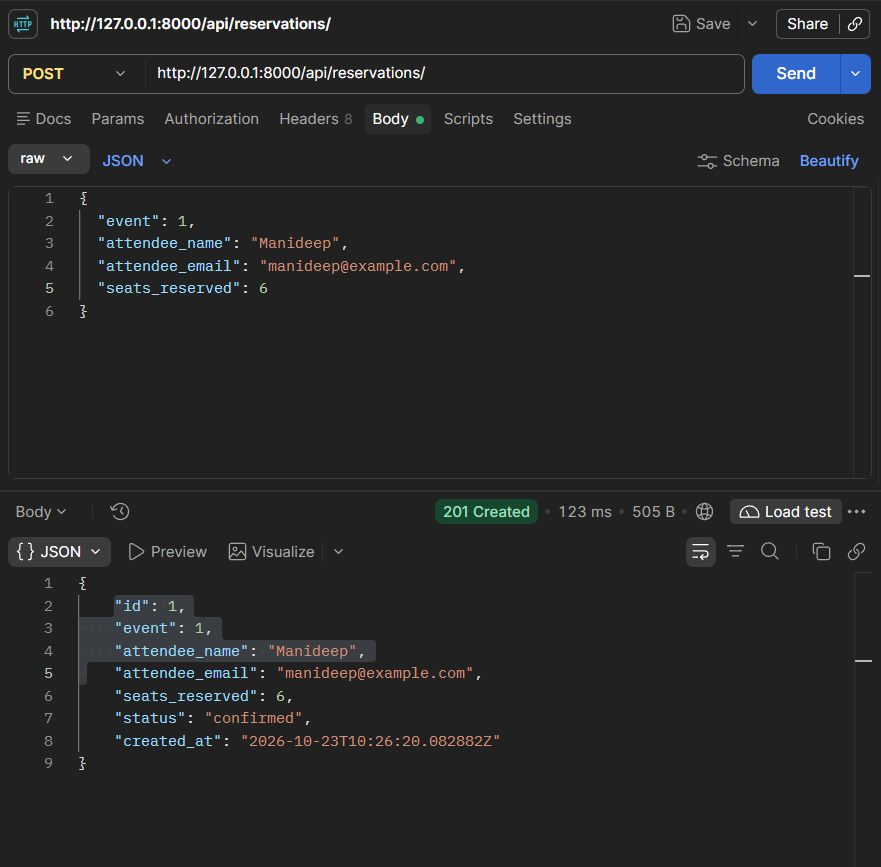
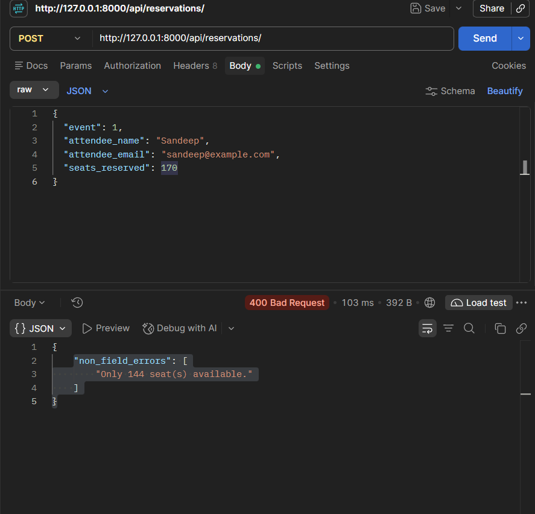
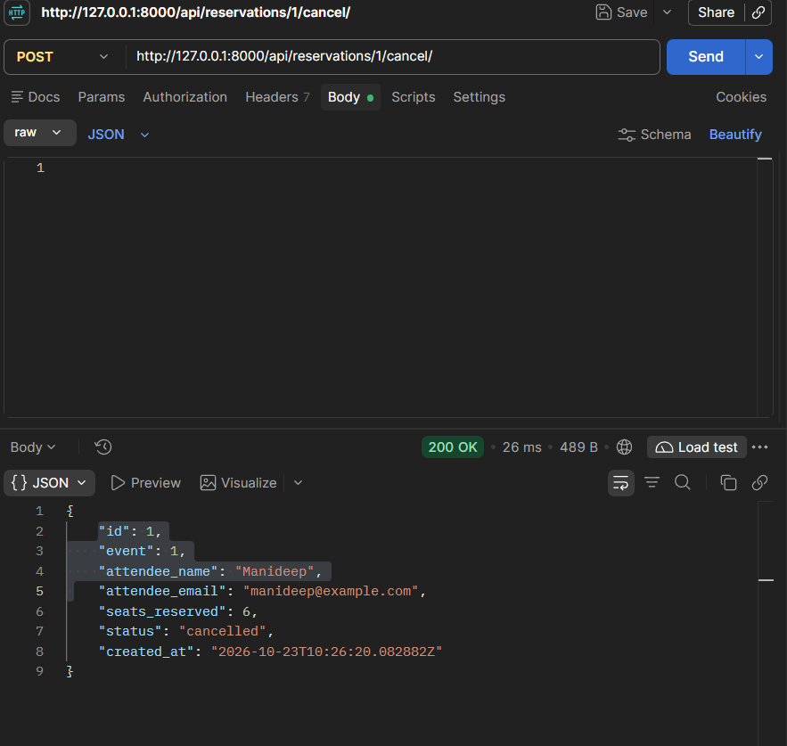

# EventHub

Backend API for a simplified event ticketing platform. Users can browse events, reserve seats, and cancel reservations.

Built with Django ORM, Django REST Framework serializers, and ViewSets + Routers.

## How to Run

```bash
git clone https://github.com/manideep311/Eventhub.git
cd Eventhub

python -m venv .venv
.venv\Scripts\activate

pip install -r requirements.txt
python manage.py migrate
python manage.py runserver
```

API root: http://127.0.0.1:8000/api/

`RequestLoggingMiddleware` prints a line in the terminal for each request:

```
POST /api/reservations/ - 201 - 0.06s
```

## Endpoints

### Events

| Method | URL | What it does |
|---|---|---|
| GET | `/api/events/` | List all events, ordered by date |
| GET | `/api/events/?status=upcoming` | Filter events by status (`upcoming`, `ongoing`, `completed`, `cancelled`) |
| GET | `/api/events/?venue=bangalore` | Filter events by venue (case-insensitive, partial match) |
| POST | `/api/events/` | Create an event. Rejects `available_seats` greater than `total_seats` |
| GET | `/api/events/{id}/` | Get one event, including `reservations_count` (confirmed reservations) |
| PUT | `/api/events/{id}/` | Update all fields of an event |
| PATCH | `/api/events/{id}/` | Update some fields of an event |
| DELETE | `/api/events/{id}/` | Delete an event and its reservations |

### Reservations

| Method | URL | What it does |
|---|---|---|
| GET | `/api/reservations/` | List all reservations, newest first |
| GET | `/api/reservations/?event_id=1` | Filter reservations by event |
| POST | `/api/reservations/` | Reserve seats. Deducts seats from the event. Returns 400 if the event is not `upcoming`/`ongoing` or not enough seats are left |
| GET | `/api/reservations/{id}/` | Get one reservation |
| PUT | `/api/reservations/{id}/` | Update all fields of a reservation |
| PATCH | `/api/reservations/{id}/` | Update some fields of a reservation |
| DELETE | `/api/reservations/{id}/` | Delete a reservation |
| POST | `/api/reservations/{id}/cancel/` | Cancel a reservation and restore its seats to the event. Returns 400 if already cancelled |

### Sample requests

Create event: `POST /api/events/`

```json
{
  "title": "PyCon India 2025",
  "venue": "NIMHANS Convention Centre, Bangalore",
  "date": "2025-09-20",
  "total_seats": 500,
  "available_seats": 500,
  "status": "upcoming"
}
```

Reserve seats: `POST /api/reservations/`

```json
{
  "event": 1,
  "attendee_name": "Priya Sharma",
  "attendee_email": "priya@example.com",
  "seats_reserved": 2
}
```

Overbooking returns `400 Bad Request`:

```json
{
  "non_field_errors": ["Only 1 seat(s) available."]
}
```

Cancel reservation: `POST /api/reservations/1/cancel/` (no body). Returns the reservation with `"status": "cancelled"`.

## Design Decision

Cancelling a reservation sets its status to `cancelled` instead of deleting it. The `cancel` action (`POST /api/reservations/{id}/cancel/`) adds the seats back to the event and keeps the row in the database.

Keeping the row means you can still see who booked and who cancelled. A second cancel on the same reservation returns 400, so the seats can't be added back twice. `reservations_count` only counts confirmed reservations, so cancelled ones don't change it.

## Screenshots

### Successful reservation (201 Created)


### Overbooking failure (400 Bad Request)


### Successful cancellation

